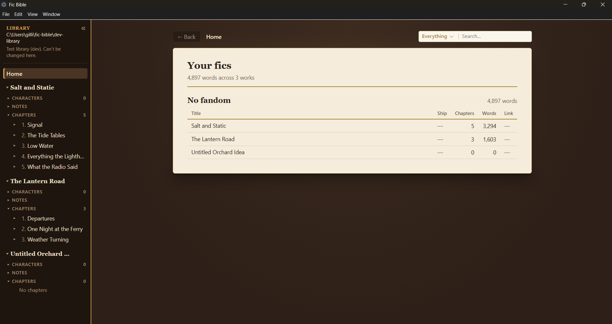
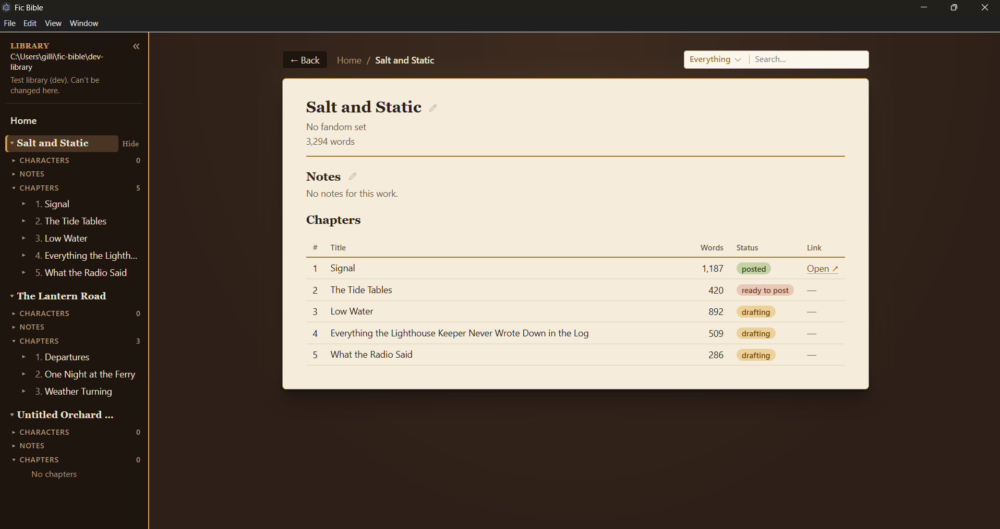
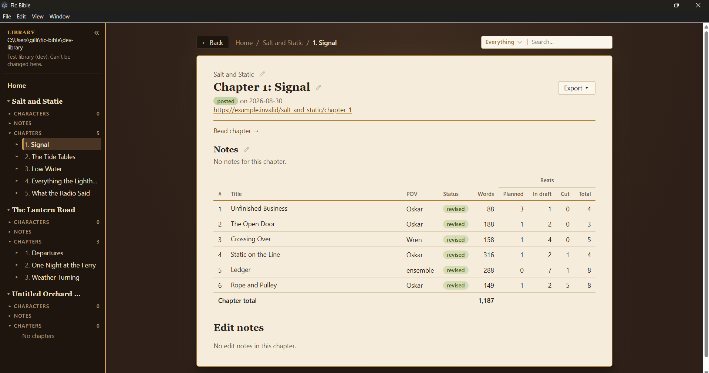
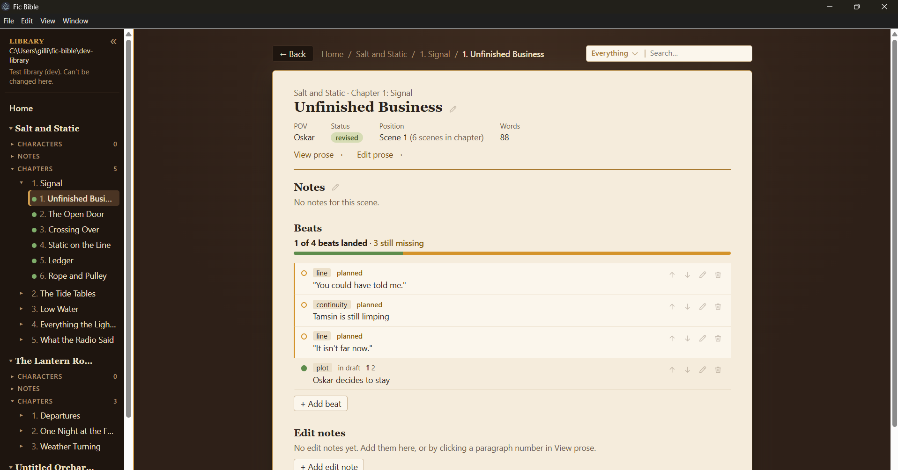
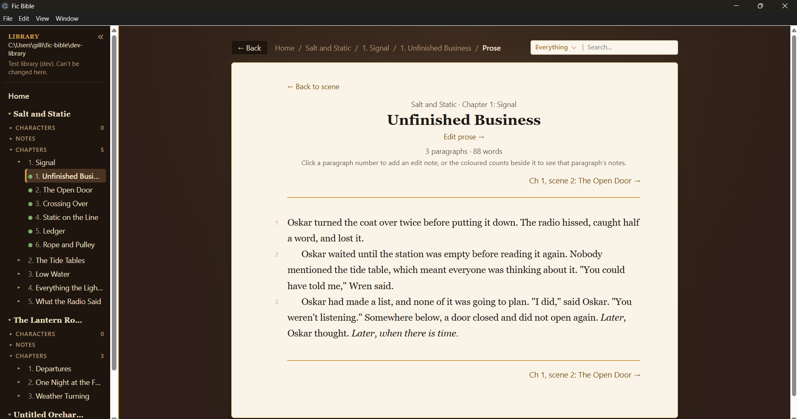
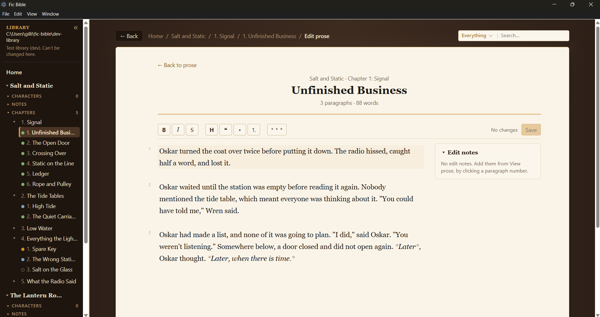

# Fic Bible

## Description

Fic Bible is a local desktop app for tracking the structure of fanfiction:
works → chapters → scenes → beats. Prose stays in plain markdown files in a
library folder you choose. Everything *about* the prose (scene status, POV,
beats, notes, characters, timelines) lives in a local SQLite database.
Wordcounts are always read from the files, so they never go out of date.

It runs on Windows and Linux, works entirely offline, and never makes a
network request. The full design is in [docs/spec.md](docs/spec.md).

## Purpose

I kept my fic bible (the structural notes for each story) in a spreadsheet,
and the spreadsheet failed at four things:

- **Cross-referencing.** Finding every scene where a thread, object or
  callback appears meant scanning rows by hand.
- **Seeing the shape at a glance.** Rows don't show pacing, POV balance, or
  where a thread goes quiet.
- **Staying current.** Upkeep was manual enough that it drifted out of date.
- **Linking to the prose.** There was no way to get from a row to the
  passage it describes.

Fic Bible holds the same notes in a real data model, so it can answer
questions a spreadsheet can't, and it ties every note back to the scene and
paragraph it's about.

## Features

- **Navigation sidebar.** Every work, expanding to its characters, notes and
  chapters, and chapters to scenes, with each scene's status at a glance.
  New works, chapters, scenes, characters and note pages are created here.
- **Home page and work overview.** Total wordcounts, works grouped by
  fandom with their ship, and each work's chapters with status and links.
- **Chapter overview.** Every scene as a table (position, title, POV,
  status, wordcount, beats by status), so a chapter's shape is readable
  without clicking into anything. A read view shows the whole chapter's
  prose on one page.
- **Scene detail.** The scene's fields and its beats, editable in place:
  add, reorder, change kind or status, and point a beat at a paragraph.
  POV and beat kinds suggest values you've used before.
- **Prose viewer and editor.** Read a scene with paragraph numbers, or edit
  its markdown with a formatting toolbar and explicit save. Saves refuse to
  overwrite a file that changed on disk, and keep its line endings.
- **Edit notes.** Per-paragraph corrections and notes for revising, shown as
  badges beside the paragraph and collected per scene and per chapter.
- **Characters.** A profile per character: name, age, birthday, any number
  of your own label-and-value fields, and freeform notes in a markdown file.
- **Notes.** Per work: a line dictionary for refrains, callbacks and
  dialogue, a timeline of in-fic events in story order, and freeform note
  pages.
- **Search.** Searches every work's characters, notes and chapters,
  including the prose files, with a scope menu and result tabs.
- **Chapter export.** Exports a whole chapter as an HTML fragment to paste
  into AO3, or as markdown to send to an editor.
- **Library import.** Picking a folder imports its works, chapters and scenes
  from the folder layout, and re-import picks up new files. The import never
  changes a file.
- **Hidden works.** Hide test or set-aside works without deleting anything.

## Technologies

| Area | Used |
| --- | --- |
| Language | JavaScript (ES modules), JSX, CSS, SQL |
| Desktop shell | [Electron](https://www.electronjs.org/) |
| UI | [React](https://react.dev/) |
| Database | SQLite, through [better-sqlite3](https://github.com/WiseLibs/better-sqlite3) |
| Prose editor | [CodeMirror 6](https://codemirror.net/) with its markdown language support |
| Build and dev server | [Vite](https://vite.dev/) and [electron-vite](https://electron-vite.org/) |
| Packaging | [electron-builder](https://www.electron.build/) (NSIS installer on Windows, AppImage and .deb on Linux) |
| Tests | Node's built-in test runner (`node --test`) |
| Runtime | Node.js |

There are no external APIs and no AI models in the app itself.

## AI Tools Used

- **Claude Code** (in the Claude desktop app): wrote and changed the code,
  ran the tests, and made the commits and pull requests.
- **Claude** (chat on claude.ai): helped shape the original spec, working
  out exactly what I wanted the app to look like, and refine the original
  prompts.

## Installation

There is no prebuilt release yet. You build the installer yourself, on the
platform you want to install it on.

**Build each platform on that platform.** The SQLite module (`better-sqlite3`)
is compiled from source on the build machine against Electron's headers, and
that compile can't target another OS. A Windows machine can't build the Linux
package, and the reverse is also true. The build stops with an error if you try.

Always build through the npm scripts below. They set the flag that forces
the from-source compile, and the build refuses to run without it.

The build downloads Electron, Electron's headers, and the packaging tools
the first time it runs. That download happens at build time only. The app
itself never makes a network request.

### Windows

Prerequisites:

- Node.js and npm
- Python 3
- Visual Studio Build Tools with the "Desktop development with C++" workload

```bash
git clone https://github.com/gillianthorne/fic-bible-vibecoded.git
cd fic-bible-vibecoded
npm install
npm run dist:win
```

Output: `dist/Fic Bible Setup <version>.exe`, an NSIS installer. It installs
for the current user, lets you choose the install folder, and adds a Start
menu entry and an uninstaller. `dist/win-unpacked/` holds the same app
unpacked, which you can run directly without installing.

The installer is unsigned, so Windows SmartScreen will warn the first time it runs.

### Linux

Prerequisites (Debian/Ubuntu names):

- Node.js and npm
- `build-essential` and `python3`, for compiling the SQLite module
- To run the AppImage on Ubuntu 22.04 and later: `libfuse2`
  (`libfuse2t64` on 24.04)

```bash
sudo apt install build-essential python3
```

```bash
git clone https://github.com/gillianthorne/fic-bible-vibecoded.git
cd fic-bible-vibecoded
npm install
npm run dist:linux
```

Output: an `.AppImage` and a `.deb` in `dist/`.

Before publishing the deb, replace the placeholder `maintainer` address in
`electron-builder.yml`.

## Running the Application

**Installed app:** start Fic Bible from the Start menu (Windows), or run the
AppImage or the installed .deb (Linux). On first start, use
**Choose folder…** at the top of the sidebar to pick your library folder
(see [Library folder layout](#library-folder-layout)).

**From source, in development:**

```bash
npm install
npm run dev
```

`npm install` also rebuilds the native SQLite module against Electron
(`postinstall`).

**Trying it with test data:** `npm run dev:test` runs the app against a
seeded test library, so you can look around without a library of your own.

Other scripts:

| Script | Does |
| --- | --- |
| `npm test` | Runs the test suite |
| `npm run migrate` | Applies database migrations without launching the app |
| `npm run seed` | Regenerates the test library. It refuses to run on a folder without the `.ficbible-test-library` marker file, so it can't touch a real library |

## How AI Was Used

The whole app was built by directing Claude Code. Before any code, I used
Claude chat to work out what I wanted: it helped me shape the design spec
([docs/spec.md](docs/spec.md)) and refine the first session prompts. I set
the project rules in
[CLAUDE.md](CLAUDE.md): files own the prose, the database owns everything
about it, wordcounts are never stored, no network requests, and no writes to
files with content except a guarded save from the editor. Each session
started from a prompt that pointed Claude Code at the spec, asked for a plan
first, and set what was in and out of scope. Claude Code then proposed a
plan, waited for my okay, wrote the code and tests, and made small commits
that I reviewed and merged as pull requests. My prompts are logged in
[docs/log.md](docs/log.md).

Three prompts that shaped the application:

**1. Proving the risky parts first.** Before any screens existed, this
session checked that Electron, the native SQLite module and file reading
all worked together on both platforms.

```text
Read CLAUDE.md and docs/spec.md before anything else.

Don't write code yet. Give me a plan first and wait for my okay.

Goal for this session: a minimal Electron + React app that proves the
risky parts work. Nothing from the spec's four screens yet.

Scope:
- Electron window opens, React renders in it
- A SQLite database file is created in the per-user app data directory
  and a trivial query runs against it successfully
- The app reads one scene markdown file from disk, counts its words
  and paragraphs, and displays both
- The library root is read from config, with a hardcoded fallback for now

Out of scope: the schema, any of the four screens, any styling beyond
what's needed to see that it works.

Constraints:
- The native SQLite module must be rebuilt against Electron, not system
  Node. Set this up properly in the build config now.
- All paths through Node's path module.
- Ask before adding any dependency, and tell me what it's for.

When it runs, tell me the commands to start it in dev and to produce
installable builds for Linux and Windows.
```

**2. The schema and migration runner.** This set the data model every later
feature builds on, and ruled out stored wordcounts from the start.
(Excerpt; the full prompt is in [docs/log.md](docs/log.md).)

```text
Goal: the full schema from the spec, plus a migration runner.

Migrations:
- Numbered SQL files in a migrations/ directory (0001_initial.sql, etc.)
- A runner that checks SQLite's user_version pragma, applies any
  migrations newer than it, in order, and updates user_version
- Each migration runs in a transaction; a failure rolls back and stops
- Applying migrations on app start is fine, but the runner must also be
  callable on its own so I can run it without launching the app
- No migration library

[...]

Do not create: wordcount columns of any kind, a lookup table for beat
kinds or POV, or any table not in the spec.
```

**3. A seeder that can't touch real fic.** This gave every later session
realistic test data with deliberate edge cases, behind a guard that keeps it
away from my real library. (Excerpt.)

```text
Safety guard, build this first: the seeder refuses to run unless the
target library root contains a marker file named .ficbible-test-library.
If the marker is absent, it aborts with an explanatory error and writes
nothing. My real fic lives in a library with no marker, and the seeder
must be incapable of touching it.

[...]

Include these edge cases deliberately:
- a scene whose file is empty
- a scene with no beats
- a chapter with exactly one scene
- a work with no chapters
- one scene file written with CRLF line endings
- repeated POV values and beat kinds across scenes, so the suggestion
  queries have something to deduplicate
```

## Screenshots

All screenshots show the seeded test library (`npm run dev:test`).



*The home page: the total wordcount, and every work grouped by fandom with
its chapter count and wordcount. The sidebar on the left lists every work's
characters, notes and chapters.*



*The work overview: the work's notes, and each chapter with its wordcount,
status and posted link.*



*The chapter overview: every scene with its POV, status, wordcount and beat
counts by status, plus the chapter total, Export menu and edit notes.*



*The scene detail: the scene's POV, status, position and wordcount, and its
beats with a progress bar for how many have landed. Beats can be reordered,
edited and deleted in place.*



*The prose viewer: the scene's text with paragraph numbers, which beats and
edit notes point to, and links to the previous and next scene.*



*The prose editor: the markdown source styled as it reads, with a formatting
toolbar, paragraph numbers, the scene's edit notes alongside, and an
explicit Save.*

## Future Improvements

1. **Wordcount history.** A snapshots table, written on a scan you trigger,
   to show progress over time, without breaking the rule that wordcounts
   come from the files.
2. **Cross-reference views.** Every scene where a given beat kind or POV
   appears, to answer "where does this thread go quiet?" directly.
3. **Synced database.** Keep the database in the library folder, so a cloud
   folder such as OneDrive carries it between laptops with the prose. A
   cloud service can't merge a database, so the app would need to detect
   and warn about conflict copies.
4. **Signed installers and published releases**, so installing doesn't
   mean building from source and SmartScreen doesn't warn.

## Reference

### Where the installed app keeps its data

The database and config live in Electron's per-user application data
folder, not inside the installed app:

| Platform | Folder |
| --- | --- |
| Windows | `%APPDATA%\Fic Bible\` |
| Linux | `~/.config/Fic Bible/` |

- `fic-bible.sqlite` is the database. It is created and migrated on first start.
- `config.json` gives the location of your library folder. Use
  **Choose folder…** at the top of the sidebar to pick it, and the app
  saves it here. That's the only time the app writes this file. You can
  also write it yourself:

  ```json
  { "libraryRoot": "C:\\Users\\you\\Documents\\fic-library" }
  ```

  The path must be absolute. On Linux, write it as `"/home/you/fic-library"`.
  Without this file the app still starts, but it can't find any prose.

`npm run dev` uses the **same** folder, so the dev app and the installed app
share one database and one `config.json`.

### Library folder layout

Choosing a folder imports it. **Re-import** picks up files you've added
since then. The import reads the folders and adds database rows. It never
creates, renames or changes a file.

```
fic-library/
  The Long Winter/          a work, titled "The Long Winter"
    characters/
      Marie.md              a character, "Marie": her notes
    notes/
      Logline.md            a note page, "Logline"
    chapters/
      01-First Snow/        chapter 1, "First Snow"
        01-arrival.md       scene 1, "arrival"
        02-the cabin.md     scene 2, "the cabin"
      02-Thaw/              chapter 2, "Thaw"
```

- A work folder with no `chapters/` folder is reported and gets no chapters. Before this layout, chapter folders sat directly in the work folder: move them into `chapters/` by hand. The app doesn't move files.
- The number before the hyphen sets the order. The title is everything after `##-`.
- Rows that already exist are left as they are, so edits made in the app survive a re-import.
- Anything that doesn't fit this layout is skipped and listed with a reason. That includes:
  - files without a `##-` prefix
  - files that aren't `.md`
  - two items with the same number
  - folders nested inside a chapter
- Hidden files and folders (starting with `.`) are ignored.

If you choose a folder that's missing some works already in the database, the app asks whether to keep those works or clear them. Clearing deletes their database rows, including beats. It doesn't delete files.

### What ships in the package

The `files` list in `electron-builder.yml` controls what goes into the
package. It includes only the built app (`out/`), `package.json`, the SQL
migrations, and the runtime dependencies. The seeder (`scripts/`), the tests
(`test/`), `dev-library/` and `library/` are not included.
